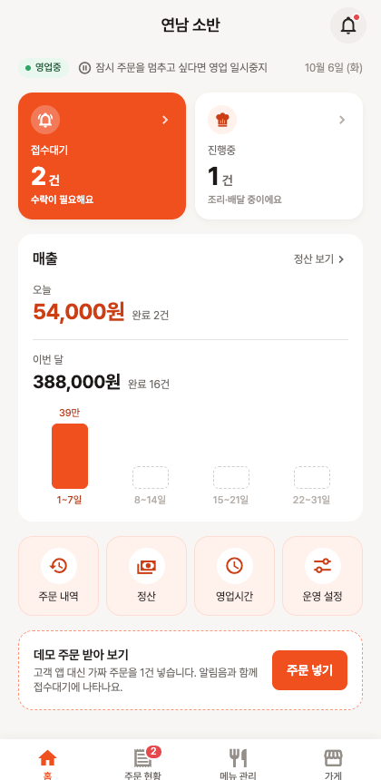
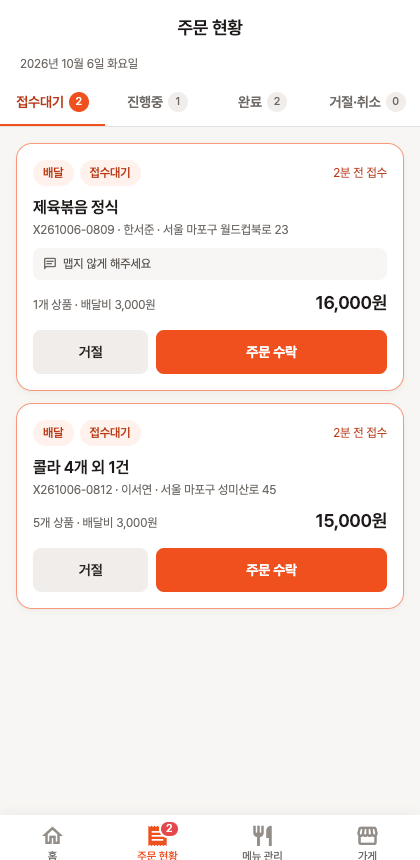
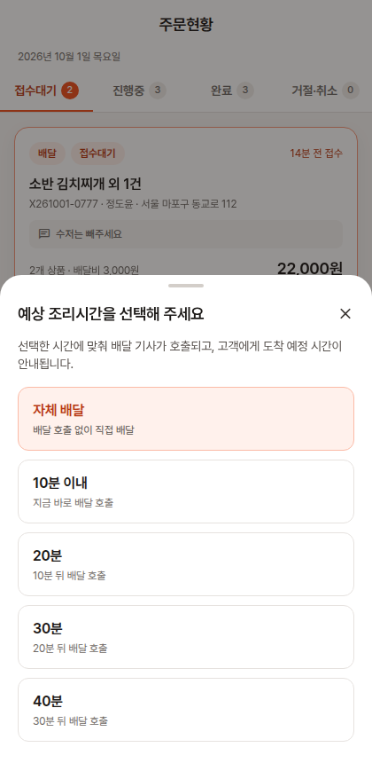
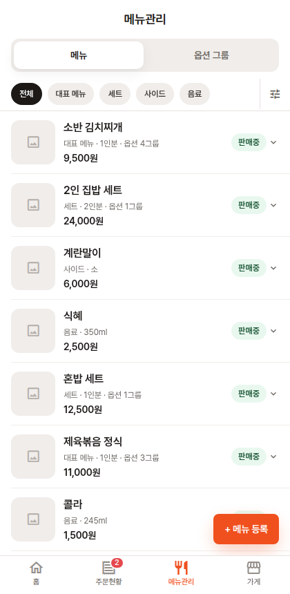

<p align="center">
  
</p>
<h1 align="center">Xoeat 사장님</h1>
<p align="center">배달 플랫폼의 <b>가맹점(사장님) 앱</b>. 주문을 받아 수락·거절하고, 메뉴와 가게 운영을 관리합니다.<br>React Native(Expo) 한 코드베이스로 iOS · Android · Web 에서 동작합니다.</p>

<p align="center">
  
  
  
  
</p>

<!-- 배포 후 채우기: 웹 데모 URL -->

구매자 앱 [xoeat-customer](https://github.com/xoheeoh/xoeat-customer) 와 **같은 Supabase 프로젝트**를 씁니다.
구매자 앱에서 주문하면 이 앱의 접수대기에 알림음과 함께 뜨고, 여기서 수락·조리·배달 처리를 하면 구매자 앱의 주문 상태가 실시간으로 바뀝니다.

## 데모 계정

| 아이디 | 비밀번호 | 가게 |
| --- | --- | --- |
| `owner01` | `demo1234!` | 연남 소반 (한식) |
| `owner02` | `demo1234!` | 망원 소반 — 다른 사람이 `owner01` 을 쓰고 있을 때 |

두 가게 모두 메뉴 12개 · 옵션 그룹 4개 · 지난 30일 주문 이력 · 오늘 진행중 주문이 들어 있습니다.
그 외 가게 4곳(`owner03`~`owner06`, 치킨·피자·카페·분식)은 구매자 앱의 가게 목록을 채우기 위한 것이고 같은 비밀번호로 로그인됩니다.
가맹점 계정은 플랫폼이 발급하는 것이라 회원가입 화면은 없습니다. 데모 데이터는 예고 없이 초기화될 수 있습니다.

> 구매자 앱을 띄우지 않고도 시연할 수 있게 홈 화면에 **"데모 주문 받기"** 버튼을 두었습니다. 가짜 고객 주문을 1건 넣어 주고,
> 실제 서비스처럼 Realtime 으로 알림음과 함께 접수대기 목록에 나타납니다.

---

## 3분 둘러보기

1. **홈** — `owner01` 로 로그인하면 영업 상태, 접수대기·진행중 건수, 오늘 매출(완료 건수)과 이번 달 매출(주 단위 추이)이 보입니다.
   오른쪽 위 종 아이콘은 **알림함**입니다. 새 주문·고객 취소·새 공지가 서버 트리거로 쌓이고, 안 읽은 게 있으면 빨간 점이 뜹니다.
2. **주문 받기** — 홈 맨 아래 `주문 넣기` 를 누르면 알림음과 함께 새 주문이 들어옵니다. 주문현황 탭 배지가 늘어납니다.
3. **수락 / 거절** — 주문현황 › 접수대기에서 `주문 수락`. 배달 주문이면 예상 조리시간(10·20·30·40분)이나 **자체 배달**을 고르고,
   포장 주문이면 바로 수락됩니다. `거절` 은 사유(재료 소진·영업 조기 마감·…·직접 입력)를 받습니다.
4. **진행** — 진행중 탭에서 포장 주문은 `포장 준비 완료 → 고객 픽업 완료`, 배달 주문은 `배달 기사에게 전달 → 배달 완료` 로 넘깁니다.
   수락 후 취소도 사유와 함께 가능합니다. 카드를 누르면 영수증·고객 정보·처리 이력이 있는 상세로 갑니다.
5. **메뉴 관리** — 메뉴 탭에서 상태 배지를 눌러 품절·숨김 처리, `+ 메뉴 등록` 으로 사진·카테고리·가격·옵션 그룹 연결까지.
   옵션 그룹 탭에서는 "맵기 선택(필수 1개)" 같은 그룹과 옵션별 추가금·품절을 관리합니다. 칩 옆 아이콘으로 카테고리 순서를 바꿉니다.
6. **가게** — 영업 일시중지/재개, 배달·포장 운영 여부, 요일별 영업시간·휴게시간, 가게 소개·원산지·최소주문금액·배달비·자체 배달 설정,
   월별 정산(매출 − 수수료 − VAT = 입금액, D+2 입금) 조회.

---

## 구조

```
xoeat-partner/
  apps/mobile/                  앱 (Expo SDK 57 · React Native 0.86 · TypeScript)
    App.tsx                     네비게이션(native-stack + bottom-tabs) · 전역 프로바이더 · 폰트 로딩
    src/screens/                Login · MainTabs(Home · Orders · Menus · Store) · 각 상세/편집 화면 15개
    src/components/common/      디자인 시스템 — Typography · Button 3종 · TextField · Dropdown · BottomSheet · Badge · ToggleSwitch 등
    src/components/order/       주문 카드 · 영수증 · 상태별 액션(수락 시트 · 거절 시트)
    src/components/home/        이번 달 매출 주 단위 막대
    src/svc/apis/               API 어댑터 — 화면이 기대하는 { resultCd, resultMsg, ... } 응답을 만든다
    src/svc/contexts/           Store(내 가게) · OrderFeed(Realtime 구독·알림음·건수) · Notification(알림함 안 읽은 개수) · Dialog · Loading
    src/svc/data/constants.ts   상태 라벨·색, 거절 사유, 조리시간 선택지, 업종
    src/styles/                 디자인 토큰 — 색(시맨틱 + 스케일) · radius · space · shadow
  docs/api-spec.md              앱이 연동 기준으로 삼은 API 명세 (상태 전이 규칙 포함)
  docs/screenshots/             README 용 화면
  supabase/                     데모용 API 서버 — 사장님·구매자 앱 공용 (아래 "범위" 참고)
  scripts/                      데모 계정 시드(사장님 6 · 회원 2) · 서버 시나리오 테스트 64건
```

### 기술 선택

| 영역 | 선택 | 이유 |
| --- | --- | --- |
| 프레임워크 | Expo (managed) | 네이티브 설정 없이 iOS · Android · Web 한 코드베이스. 채용 담당자가 빌드 없이 링크로 볼 수 있다 |
| 네비게이션 | native-stack + bottom-tabs | 사장님 앱은 "지금 들어온 주문"이 중심이라 탭 1개를 주문현황에 주고 배지로 접수대기 건수를 띄운다 |
| 실시간 | Supabase Realtime | 폴링 대신 `orders` 변경 구독. 구독은 화면이 아니라 프로바이더가 하나만 가져 어느 탭에서도 새 주문을 놓치지 않는다 |
| 알림음 | expo-audio | 새 주문 INSERT 에만 울린다. 가게 탭에서 끌 수 있다 |
| API 연동 | 어댑터 계층 (`svc/apis`) | 화면은 응답 계약만 보고, Supabase 호출은 어댑터에 격리 |
| 이미지 | expo-image-picker + Supabase Storage | 정사각 크롭 후 업로드, DB 에는 URL 만 |
| 스타일 | `StyleSheet` + 디자인 토큰 | 색은 `theme.colors.<key>` 로만. 화면 코드에 hex 없음 |
| 폰트 | Pretendard (OFL) | 네이티브 otf, 웹 woff2 |

### 지킨 원칙

**주문 상태는 서버가 바꾼다.** 앱은 `orders` 테이블에 UPDATE 권한이 없고, 수락·거절·취소·진행은 모두 RPC 다.
서버가 전이 규칙(접수대기에서만 수락, 배달 주문은 조리시간 필수, 완료 뒤에는 아무것도 못 함)을 검사하므로
두 기기에서 같은 주문을 동시에 처리해도 한 번만 반영되고, 나머지는 `INVALID_TRANSITION` 을 받아 목록을 새로고침한다.

**새 주문은 어느 화면에 있어도 알린다.** Realtime 구독·알림음·건수 갱신을 `OrderFeedProvider` 한 곳에 두고,
화면은 `lastEvent` 를 보고 자기 목록만 다시 읽는다. 홈의 매출 숫자도 같은 이벤트로 갱신된다.

**오류는 코드로 받고, 문구는 앱이 정한다.** `COOKING_MINUTES_REQUIRED`, `STORE_PAUSED` 같은 코드를
`svc/apis/client.ts` 한 곳에서 문구로 바꾼다.

**웹에서도 같은 화면이 깨지지 않는다.** SecureStore·사진 선택처럼 플랫폼이 갈리는 것은 어댑터와 컴포넌트 안에 있고,
웹 화면은 최대 700px 프레임으로 가운데 정렬해 모바일 레이아웃을 그대로 보여 준다.

**디자인은 토큰에서 시작한다.** 색·라운드·여백·그림자를 `src/styles` 에 모으고 공통 컴포넌트가 그것만 참조한다.
주문 상태 색(접수대기=브랜드 오렌지, 조리중=파랑, 배달중=보라, 완료=회색, 거절·취소=빨강)도 `constants.ts` 한 곳에 있다.

---

## 범위

이 저장소에서 작성한 것은 `apps/mobile` 의 앱 전체입니다 — 화면, 디자인 시스템, API 어댑터, Realtime 처리, 플랫폼 분기, 오류 처리.

`supabase/` 는 앱을 실제로 동작시키기 위한 **데모용 API 서버**입니다. 실무에서는 백엔드 팀이 명세와 함께 제공하는 영역이며,
이 프로젝트에서는 그 역할을 대신할 서버를 AI 도구로 생성해 사용했습니다. 앱은 [`docs/api-spec.md`](docs/api-spec.md) 의
명세만을 기준으로 연동했고, DB 설계와 서버 로직은 이 포트폴리오가 보여주려는 범위에 포함되지 않습니다.
서버 구성은 [`supabase/README.md`](supabase/README.md) 에 정리되어 있습니다.

**데모 범위 밖으로 둔 것.** 실제 가맹점 앱에는 있지만 이 데모에서는 만들지 않았습니다.

- 고객 앱은 별도 저장소([xoeat-customer](https://github.com/xoheeoh/xoeat-customer))에 있습니다. 없이도 "데모 주문 받기" 버튼으로 시연할 수 있습니다.
- 푸시 알림 — 앱이 켜져 있을 때의 Realtime 알림만 있습니다. 백그라운드 푸시(FCM/APNs)는 서버 트리거와 Expo Push 로 붙일 수 있는 자리만 두었습니다.
- 결제 취소·환불 처리 — 거절·취소 시 "환불됩니다" 안내만 하고, 실제 PG 연동은 없습니다.
- 세금계산서, 결제 내역(PG 승인 단위), 리뷰 답글, 1:1 문의 — 도메인 난이도보다 화면 수만 늘리는 항목이라 제외했습니다.
- 메뉴 순서 드래그 — 카테고리는 화살표로 순서를 바꾸고, 메뉴는 등록 순서를 따릅니다.

---

## 직접 실행하기

Supabase 무료 프로젝트와 Node 20 이상이 필요합니다. Docker 는 필요하지 않습니다.

```bash
# 1. 데모 API 서버
npm install
npm run login
npm run link -- --project-ref <ref>
npm run db:push                 # 스키마 + RLS + 함수 + 공지 시드
npm run config:push             # auth 설정 (구매자 회원가입 허용, 이메일 확인 없음)
SUPABASE_URL=https://<ref>.supabase.co SUPABASE_SERVICE_ROLE_KEY=<service_role> npm run seed:demo   # 가게 6곳 + 회원 2명

# 2. 앱
cd apps/mobile
cp .env.example .env            # URL, anon key
npm install
npm run web                     # 또는 npm run ios / npm run android
```

<details>
<summary>로컬 Docker 스택으로 띄우기</summary>

```bash
npm run db:start                # Docker Desktop 필요
npm run db:test                 # 마이그레이션 + 시드 + 서버 시나리오 테스트 64건
SUPABASE_URL=http://127.0.0.1:54321 SUPABASE_SERVICE_ROLE_KEY=<db:status 의 service_role key> npm run seed:demo
```

앱 `.env` 에는 `http://127.0.0.1:54321` 과 로컬 anon key 를 넣습니다. 실기기는 127.0.0.1 대신 PC 의 LAN IP.

Docker 없이 순정 Postgres 로 서버만 검증하려면 `PGURL=postgres://... ./scripts/verify.sh --shim`.

</details>

---

## 문서

- [`docs/api-spec.md`](docs/api-spec.md) — API 명세, 주문 상태 전이, 오류 코드
- [`apps/mobile/README.md`](apps/mobile/README.md) — 앱 폴더 구조와 플랫폼 분기
- [`supabase/README.md`](supabase/README.md) — 데모 API 서버 구성
